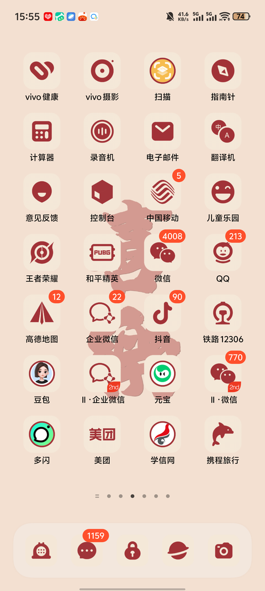
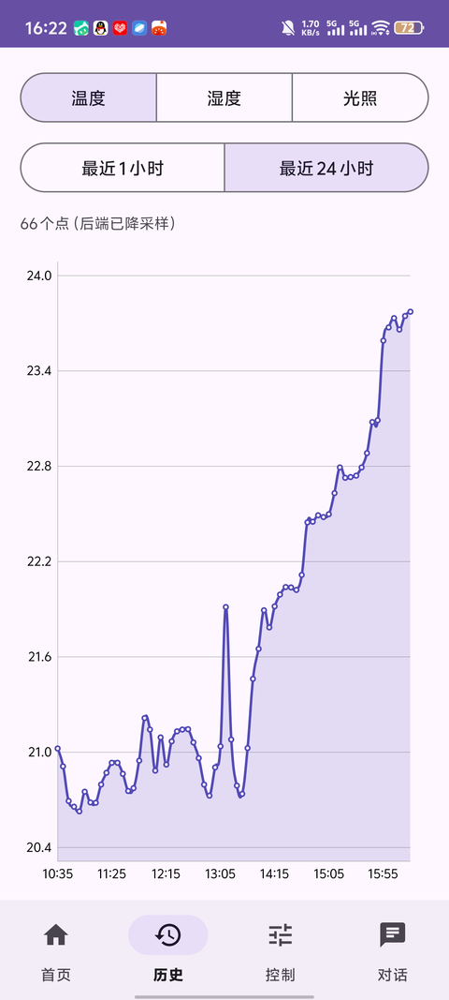
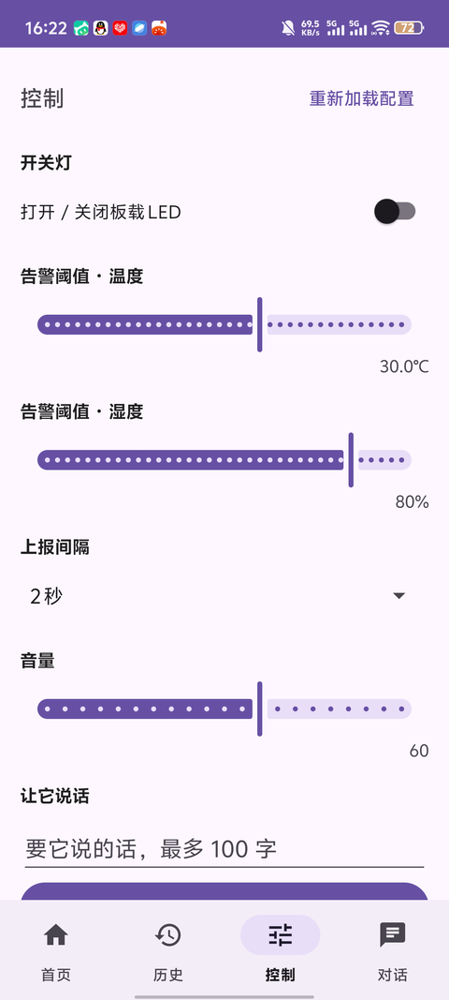
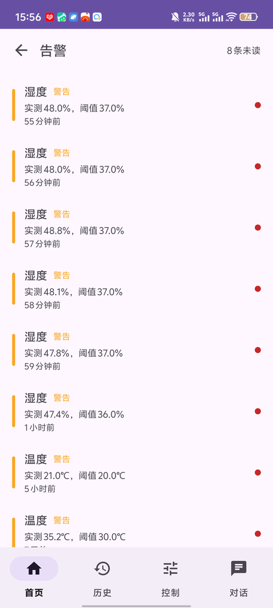
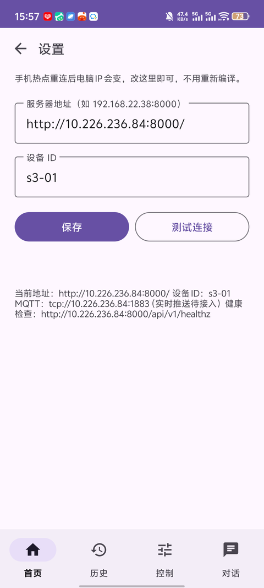

# IoTApp · 物联网 AI 语音管家（Android 端）

配合 ESP32 节点 `s3-01` 采集温湿度与光照，提供实时监控、历史曲线、远程控制、AI 文字对话与告警处理的 Android 客户端。

数据全部来自自建后端（HTTP + MQTT），App 本身不做任何告警判定与降采样——后端给什么就显示什么。

## 界面

<table>
  <tr>
    <td align="center"><br><sub>首页 · 实时数据与告警角标</sub></td>
    <td align="center"><br><sub>历史 · 折线图（后端降采样）</sub></td>
    <td align="center"><br><sub>控制 · 全部由 /config 渲染</sub></td>
  </tr>
  <tr>
    <td align="center"><br><sub>告警 · 级别色条与已读状态</sub></td>
    <td align="center"><br><sub>设置 · 地址可现场修改</sub></td>
    <td></td>
  </tr>
</table>

## 功能

| 页面 | 能力 |
|---|---|
| 首页 | 温度 / 湿度 / 光照三张卡片、在线状态、相对更新时间、下拉刷新；数据陈旧时置灰提示；右上角告警入口带未读角标、设置入口 |
| 历史 | 温度 / 湿度 / 光照切换，最近 1 小时 / 24 小时，MPAndroidChart 折线图，标注"后端已降采样" |
| 控制 | 开关灯、温度阈值、湿度阈值、上报间隔、音量、朗读文本；**全部由 `/config` 的 `commands` 与 `thresholds` 渲染，XML 里不写死任何范围值** |
| 对话 | AI 文字问答，支持后端返回的 `action`（如顺带控制设备） |
| 告警 | 级别色条（info / warn / danger）、实测值与阈值对比、相对时间、未读圆点；点击单条即标记已读 |
| 设置 | 服务器地址、设备 ID、测试连接；改完不用重新编译 |

底部导航 4 个 Tab（首页 / 历史 / 控制 / 对话），告警与设置是首页右上角进入的二级页面，返回键可退。

## 技术栈

- **Kotlin**，UI 用 XML + ViewBinding（不用 Compose）
- **AGP 9.5 / Gradle 9**，Kotlin 由 AGP 内建，不再单独 apply 插件
- **Retrofit 2.11 + Gson + OkHttp**，普通接口 5 秒超时，AI 对话单独 15 秒
- **Coroutines + Flow / StateFlow**，UI 只订阅状态
- **Material 3 + MPAndroidChart**
- **JUnit4** 做契约测试与 Mapper 测试

## 架构

```
UI (Fragment) ──> ViewModel ──> DeviceRepository ──> Retrofit (ApiService)
     ↑                ↑                  ↓
  只读 UiModel    暴露 UiState      把 DTO 转成 UiModel
```

三条硬规则：

1. UI 层只碰 `UiModel`，不允许出现任何 `DTO`；
2. 所有网络请求必须经过 `DeviceRepository`，UI 不直接调 `ApiService`；
3. `core` 包不依赖 `data` / `retrofit` / `gson`，保证错误码与状态定义干净。

统一状态封装是 `UiState<T>`（`Loading` / `Success` / `Offline` / `Error`），其中 `Offline` 会带上一次成功的数据，断网时界面仍能显示旧值并置灰。

## 快速开始

**环境要求**

- Android Studio（支持 AGP 9.5 的版本）
- JDK 17
- `compileSdk 37` / `minSdk 24` / `targetSdk 34`

**步骤**

```bash
git clone git@github.com:LinMistVale/IoTApp.git
```

1. 用 Android Studio 打开仓库根目录，首次打开会提示指定 SDK 路径（自动生成 `local.properties`）
2. 改后端地址：编辑 `app/src/main/java/com/example/iotapp/core/AppConfig.kt` 里的 `BASE_URL` / `MQTT_URL`
3. 编译安装：

```bash
./gradlew :app:assembleDebug      # 产物 app/build/outputs/apk/debug/app-debug.apk
./gradlew :app:testDebugUnitTest  # 单元测试
```

也可以先装 App 再改地址：**设置页**填服务器 IP → 保存，会重建 Retrofit 实例，无需重新编译。

`AppConfig.kt` 是唯一的配置入口（地址、MQTT、设备 ID、超时、主题），换环境只改这一个文件。

## 后端接口

契约版本 v1.1，共 9 个接口：

| 方法 | 路径 | 用途 |
|---|---|---|
| GET | `/api/v1/healthz` | 健康检查（设置页"测试连接"用） |
| GET | `/api/v1/devices/{id}/latest` | 最新遥测 |
| GET | `/api/v1/devices/{id}/history` | 历史序列（后端降采样） |
| GET | `/api/v1/devices/{id}/alarms` | 告警列表（支持 `unacked_only`） |
| POST | `/api/v1/alarms/{id}/ack` | 标记单条告警已读 |
| POST | `/api/v1/devices/{id}/command` | 下发控制命令 |
| GET | `/api/v1/devices/{id}/status` | 设备状态（数据层已就绪，界面待接入） |
| GET | `/api/v1/devices/{id}/config` | 能力发现：指标、阈值范围、命令列表 |
| POST | `/api/v1/chat/text` | AI 文字对话 |

MQTT 主题规划（客户端待接入）：`iot/{id}/telemetry`、`iot/{id}/alarm`、`iot/{id}/cmd`、`iot/{id}/cmd/ack`。

## 契约测试

13 个 JSON 夹具放在 `app/src/test/resources/contract/`，**随仓库提交**，clone 后直接可跑：

```bash
./gradlew :app:testDebugUnitTest
```

共 25 个用例：

| 测试类 | 数量 | 覆盖内容 |
|---|---|---|
| `ContractTest` | 14 | 用 MockWebServer 原样返回夹具，断言 App 能正确解析、命令体能正确构造 |
| `MapperTest` | 10 | DTO → UiModel 的边界情况（`null` 显示为 `--`、超时归类、精度格式化） |
| `ExampleUnitTest` | 1 | 工程自带 |

夹具真身就在测试资源目录里，后端哪天改了字段名，这里会立刻变红，比在群里通知可靠。改动顺序：**先改夹具真身 → 测试通过 → 再同步给后端**。

## 项目结构

```
app/src/main/java/com/example/iotapp/
├── MainActivity.kt          单 Activity + 底部导航，二级页压栈
├── core/                    AppConfig、UiState、错误码转换
├── data/
│   ├── DeviceRepository     数据层唯一入口：查询、类型化命令、缓存
│   ├── Mappers              DTO → UiModel
│   ├── AppContainer         极简依赖容器
│   └── remote/              Retrofit 客户端、ApiService、DTO
├── model/                   UiModel（界面专用模型）
├── settings/                SharedPreferences 封装
└── ui/
    ├── home/ history/ control/ chat/ alarm/ settings/
    └── common/              ViewModel 工厂
```

## 已知限制

- **MQTT 未接入**：实时推送与告警通知尚未实现，目前靠手动下拉刷新。主题与 QoS 已在 `AppConfig` 中定义好。
- **无系统通知**：新告警不会弹通知栏，需进入告警页查看。
- **未做鉴权**：接口无 token，仅用于校园网内测。
- **debug 签名**：`assembleDebug` 产物，未配置 release 签名。

## 相关文档

接口契约、Android 端开发任务书、契约夹具索引等文档由团队内部维护，未纳入本仓库。
